# Habit Tracker

Navade, opravila, projekti, zapiski, koledar, fokus in delo – vse v eni aplikaciji. Brez registracije in brez strežnika: tvoji podatki ostanejo na tvoji napravi.

**Android** · **Windows** · **Linux** · **Mac** · **iPhone** (v brskalniku)

## Prenos

**[Prenesi najnovejšo različico](https://github.com/MrJackyYT/habit-tracker-releases/releases/latest)**

| Naprava | Datoteka |
|---|---|
| Android | `HabitTracker.apk` |
| Windows | `Habit-Tracker-Setup.exe` |
| Linux | `Habit-Tracker.deb` (Ubuntu, Debian, Mint …) ali `Habit-Tracker.AppImage` |
| macOS | `Habit-Tracker-mac.dmg` (Intel in Apple silicon) |
| iPhone / iPad | brez datoteke – spletna aplikacija: [mrjackyyt.github.io/habit-tracker-releases](https://mrjackyyt.github.io/habit-tracker-releases) |

---

## ⚠️ Aplikacijo zazna kot nevarno

Habit Tracker ni iz Google Play, Microsoft Store ali App Store in nima plačljivega certifikata, s katerim bi ga sistem prepoznal. Zato ga telefon ali računalnik ob namestitvi označi kot neznano oziroma nevarno aplikacijo. To je običajno za aplikacije, ki jih preneseš s spletne strani (»third-party app«).

Google bo v letu 2027 povsod zahteval, da so vse aplikacije na Androidu od preverjenih razvijalcev. Aplikacijo nepreverjenega razvijalca bo še vedno mogoče namestiti, a po daljšem postopku: vklop načina za razvijalce, ponovni zagon telefona in **en dan čakanja**. Trenutno preučujem Googlove smernice in možnosti, da bo namestitev čim enostavnejša.

### Namestitev

**Android** – odpri preneseno datoteko in brskalniku dovoli nameščanje aplikacij. Google Play Protect lahko opozori, ker aplikacija ni iz Trgovine Play – izberi `Vseeno namesti`.

**Windows** – zaženi namestitev in sledi korakom. Habit Tracker se doda v meni Start in na namizje. Pri modrem oknu »Windows je zaščitil računalnik« klikni `Več informacij` in nato `Vseeno zaženi`.

**Linux** – `.deb` se namesti kot vsaka druga aplikacija (odpri jo ali `sudo apt install ./Habit-Tracker.deb`) in doda Habit Tracker v meni aplikacij. `.AppImage` ne potrebuje namestitve: datoteko naredi izvršljivo (desni klik → Lastnosti → Dovoli izvajanje ali `chmod +x Habit-Tracker.AppImage`) in jo odpri. Če se ne zažene, je razlog zapisan v `~/.cache/habit-tracker-start.log`.

**macOS** – odpri `.dmg` in povleci Habit Tracker v *Aplikacije*. Aplikacija nima Applovega certifikata, zato macOS prvič reče, da je ne more preveriti: odpri *Sistemske nastavitve → Zasebnost in varnost*, se pomakni dol in pritisni *Vseeno odpri* (ali desni klik na aplikacijo → *Odpri*). Če še vedno piše, da je poškodovana, enkrat v Terminalu zaženi `xattr -cr "/Applications/Habit Tracker.app"`. Blokiranje med fokusom ob začetku in koncu vpraša za geslo Maca.

**iPhone / iPad** – odpri [mrjackyyt.github.io/habit-tracker-releases](https://mrjackyyt.github.io/habit-tracker-releases) v **Safariju**, pritisni *Deli* (kvadrat s puščico) → *Dodaj na začetni zaslon* → *Dodaj*. Habit Tracker se potem odpira z začetnega zaslona kot aplikacija, čez cel zaslon in tudi brez interneta. Podatki ostanejo na iPhonu – v nastavitvah Safarija ne briši podatkov spletne aplikacije in občasno naredi varnostno kopijo (Nastavitve → Podatki → Izvozi varnostno kopijo). Na iPhonu blokiranje drugih aplikacij ni mogoče, opomniki pa se pokažejo samo, ko je aplikacija odprta.

### Posodobitve

Na Windows in Linux se aplikacija posodobi sama: novo različico prenese v ozadju in jo namesti, ko jo zapreš. Na Androidu v aplikaciji pritisneš *Posodobi* in potrdiš *Posodobi to aplikacijo?*. Na macOS aplikacija pokaže, da je izšla nova različica – preneseš nov `.dmg` in zamenjaš aplikacijo (podatki ostanejo). Spletna aplikacija (iPhone) je vedno najnovejša.

---

## FAQ

**S kakšnim namenom sem ustvaril Habit Tracker?**
Želel sem en program, v katerem je ves delovni dan na enem mestu (»All-in-One«): navade, opravila, projekti, zapiski, koledar in evidenca dela. Brez registracije in brez računov, da je občutek bolj domač.

**Kako deluje aplikacija?**
Lokalno, brez internetne povezave. Internet potrebuje samo za posodobitve, vreme in pošto. Za sinhronizacijo med dvema napravama (Local Sync) morata biti napravi v istem omrežju (LAN).

**Kako pridejo posodobitve?**
Za posodobitve aplikacija potrebuje internet. Nove različice poišče ob zagonu in vsakih nekaj ur, na istem naslovu, s katerega si jo prenesel. Opomniki in alarmi pa delujejo tudi brez interneta, ker jih ob nastavljenem času sproži naprava sama.

**Kam se shranijo podatki?**
Na računalniku v `Dokumenti › Habit Tracker`, na telefonu v `Notranji pomnilnik › Documents › Habit Tracker`, v datoteki `habit-tracker-data.json`. Varnostno kopijo narediš v Nastavitvah › Podatki › Izvozi varnostno kopijo.

**Ali bo kdaj na voljo v App Storu?**
Verjetno ne. Apple za objavo zahteva letno članarino (približno 100 € na leto). Na iPhonu Habit Tracker deluje kot spletna aplikacija: odpri jo v Safariju in izberi Deli › Dodaj na začetni zaslon.

---

## Več o lastnostih in uporabi

Vsak del lahko v Nastavitvah › Funkcije izklopiš, če ga ne potrebuješ. Podatki ostanejo shranjeni. Slike so iz aplikacije, s primeri podatkov.

### Projekti & Opravila

Vse, kar moraš narediti: od vsakodnevnih navad do večjih projektov.

- **Ponavljajoča opravila** – navade in opravila, ki se ponavljajo vsak dan, teden ali mesec. Za vsako opravljeno dobiš točke, niz dni in rang.
- **Projekti** – razvrščeni na tabli »Za narediti«, »V delu« in »Končano«. Projekt ima glavna opravila, ta pa svoja opravila, rok in napredek v odstotkih.
- **Oznake (tags)** – projektu dodaš oznako, npr. »Služba« ali »Stranke«. Pod zavihkom Oznake so projekti združeni po oznakah, vsaka oznaka pa pokaže skupni napredek vseh svojih projektov v odstotkih in koliko jih je končanih. Tako hitro vidiš, kako daleč je celotno področje.
- **Fokus na projekt** – čas, ki ga porabiš za projekt, se šteje sam, ko zaženeš fokus.

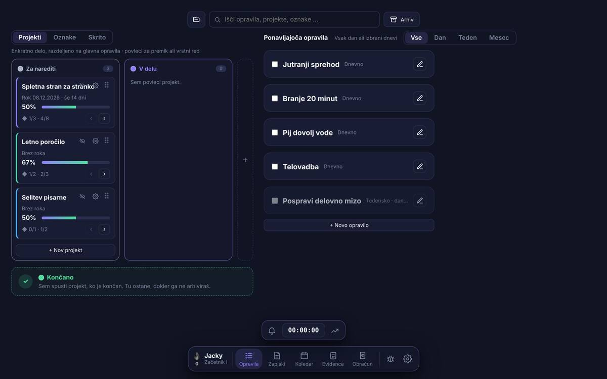
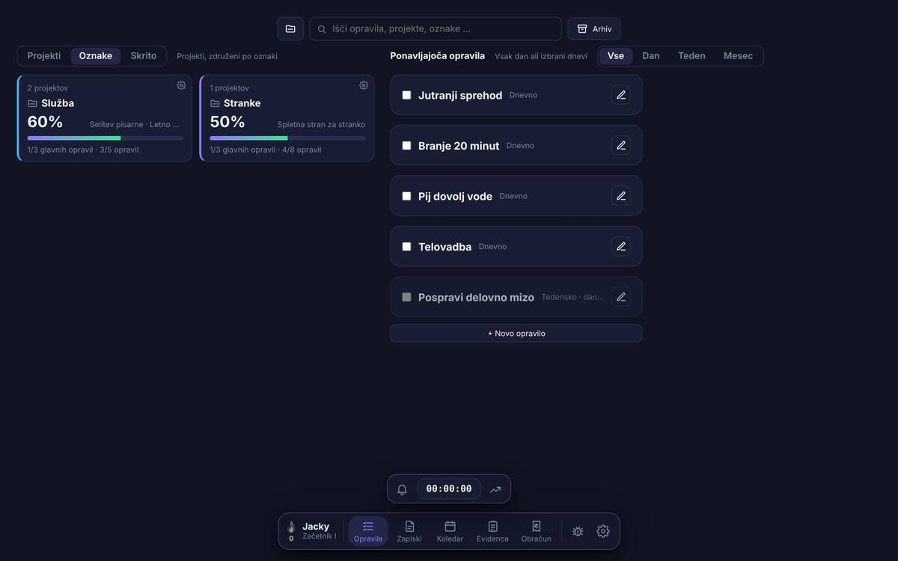
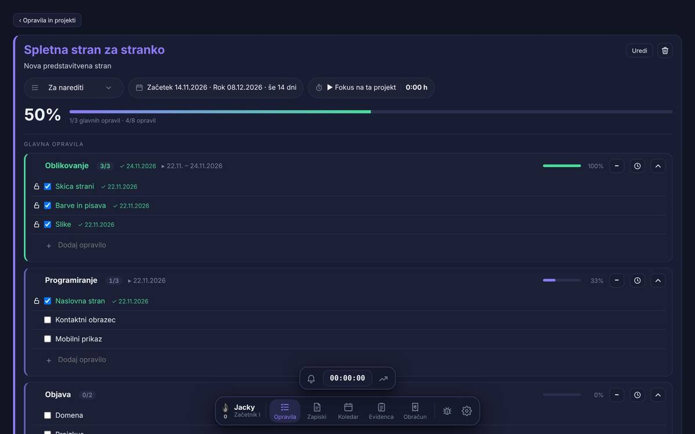

### Zapiski

Prostor za karkoli: sezname, ideje, zapiske s sestankov.

- **Mape in oznake** – zapiske razvrstiš v barvne mape in jim dodaš oznake. Premikaš jih tako, da jih povlečeš.
- **Slike** – slike prilepiš ali povlečeš v zapisek, jih povečaš (kolešček, dvoklik), kopiraš ali shraniš.
- **Povezave in videi** – prilepljena povezava se pokaže kot kartica z naslovom in sliko, video (npr. YouTube) pa z veliko predogledno sliko in gumbom ▶. Klik odpre video.

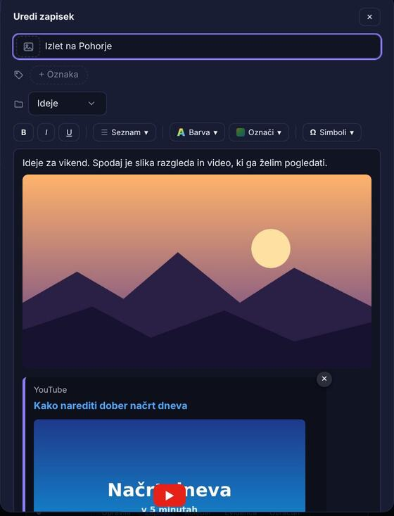

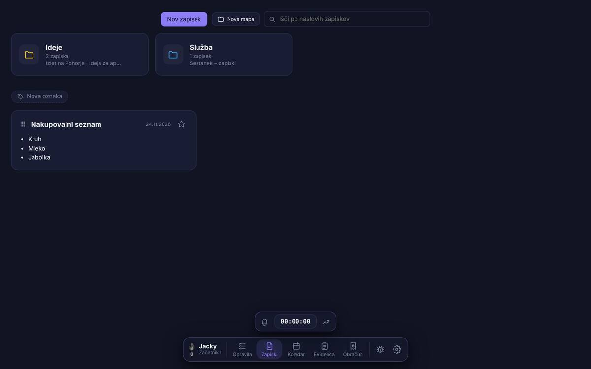

### Koledar

Deluje kot klasičen koledar z dogodki, opomniki in ponavljanjem. Projekti se v koledar zapišejo sami, na dan, ko mora biti opravilo končano. Ponavljajoča se opravila ne.

- **Označevanje dni** – prvi klik na dan ga označi. Drugi klik na *isti* dan odpre ta dan (njegove dogodke in »Nov dogodek«). Drugi klik na *poznejši* dan takoj ustvari dogodek od prvega do tega dne. Klik na prejšnji dan začne izbiro znova. Esc izbiro prekliče.
- **Oznake, prazniki, zgodovina** – dogodkom dodaš svoje oznake, slovenski prazniki so obarvani rdeče. V Zgodovini so pretekli dogodki po letih.
- **Vreme** – dodaš do 3 kraje za napoved vremena za 7 in 14 dni. Na računalniku je pod koledarjem, na telefonu ga odpreš s potegom z leve proti desni.

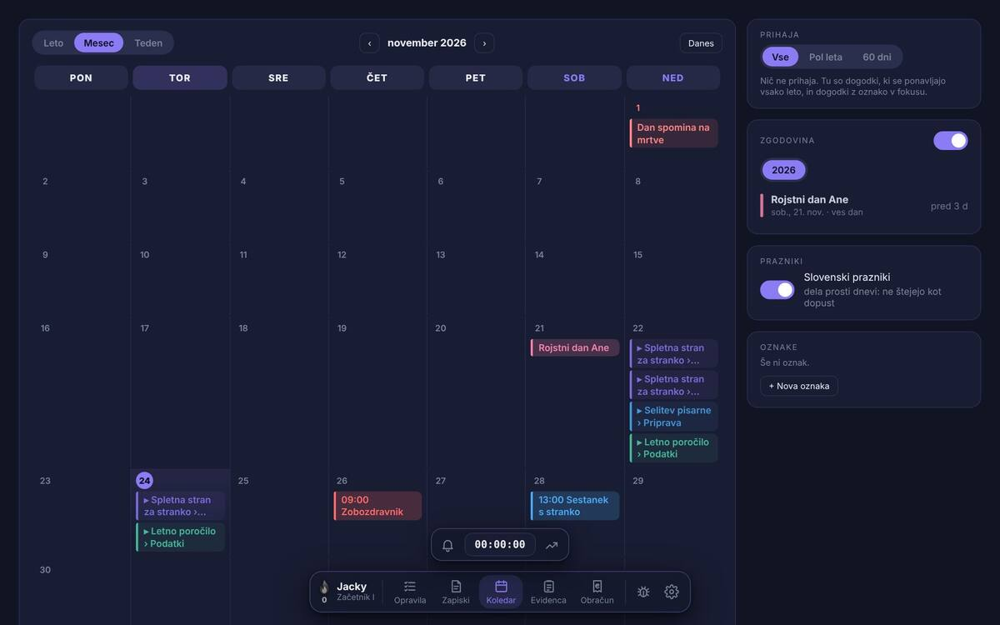

### Fokus

Časovnik za delo brez motenj. Izbereš, na čem delaš, pritisneš Začni, ure se štejejo, dokler ne ustaviš.

- **Seznam blokiranja** – strani in aplikacije, ki te med fokusom zamotijo (YouTube, Instagram …), se zaprejo. Deluje na računalniku in v Android aplikaciji. Na računalniku z gumbom Prebrskaj … dodaš tudi igro ali program, ki ga ni na seznamu.
- **Programi za fokus** – na računalniku izbereš programe, v katerih delaš (lahko več). Ura šteje samo, ko je eden od njih spredaj; ko preklopiš drugam, počaka in sama nadaljuje, ko se vrneš. Vpisano ime šteje tudi v naslovu okna, npr. zavihek brskalnika.
- **Zgodovina fokusa** – koliko si delal v zadnjih 7 dneh, mesecu, pol leta ali letu.

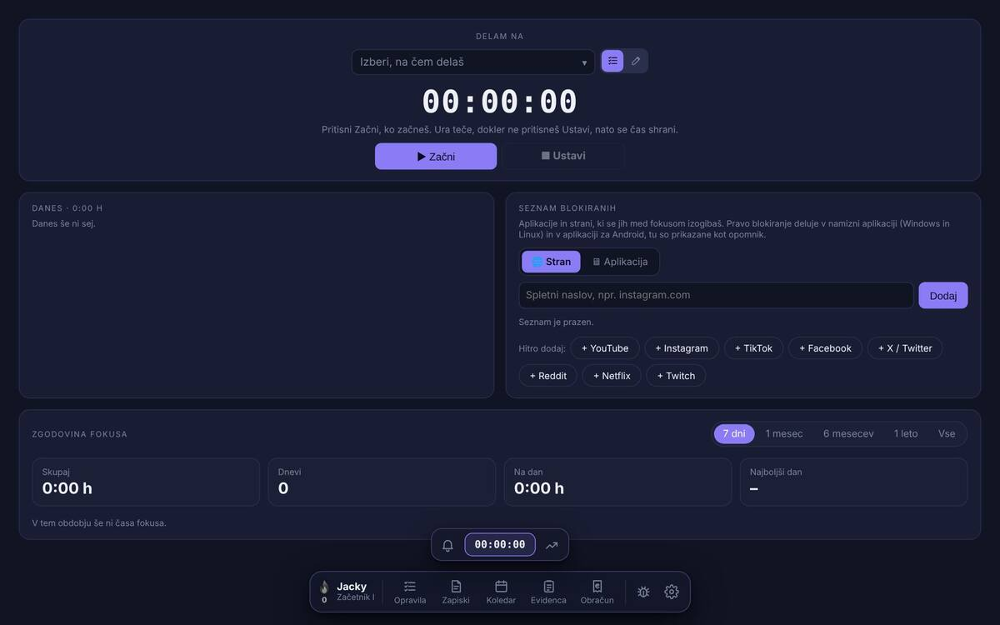

### Statistika

Dnevni napredek, graf zadnjih 7 dni ali meseca in seznam, kaj je bilo danes opravljeno. Spodaj so seštevki: končana opravila, čas fokusa, niz in končani projekti.

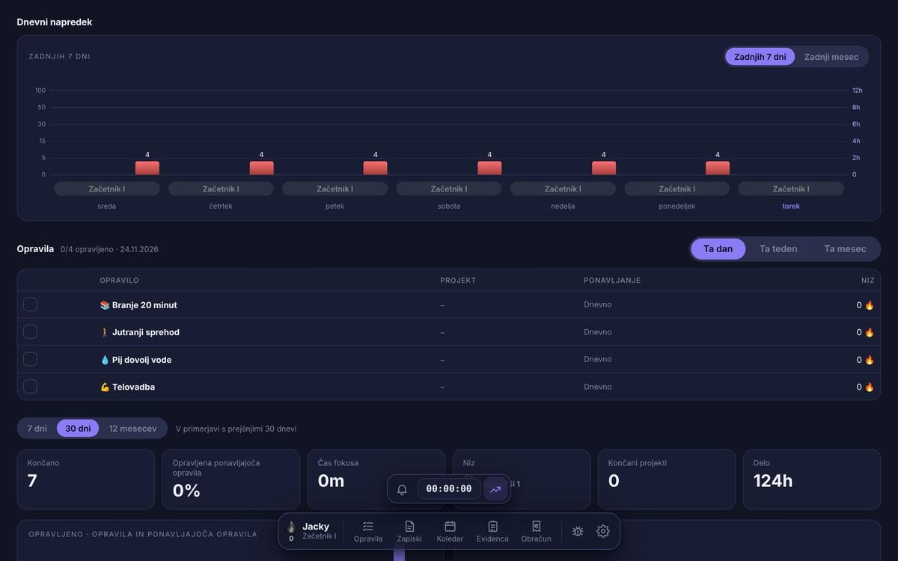

### Evidenčni list

Delovni koledar za ure, dopust, bolniško in kolektivni dopust. Klikneš prvi in zadnji dan ter izbereš, kaj je.

- **Ure in nadure** – delovne ure po dnevih in mesecih, nadure se zberejo same in jih lahko porabiš kot prost čas.
- **Dopust** – vsako leto se začne s 25 dnevi (ali številom, ki ga vpišeš). Prejšnja leta ostanejo shranjena. Prazniki se ne štejejo kot dopust.
- **Drugo – svoje vrste** – pod »Drugo« ustvariš svojo vrsto, npr. »Službena pot«, »Sestanek« ali »Izobraževanje«, ji izbereš barvo in določiš, kako se šteje: **opravičeno** (samo zapisano), **delovni čas** (normalen delovni dan, ure se štejejo) ali **dopust**.

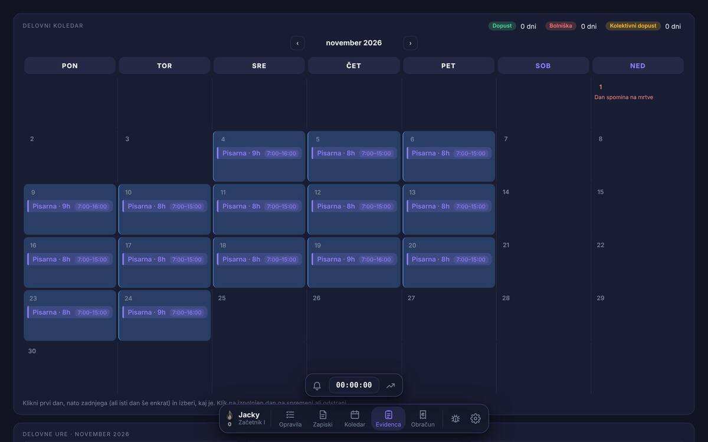

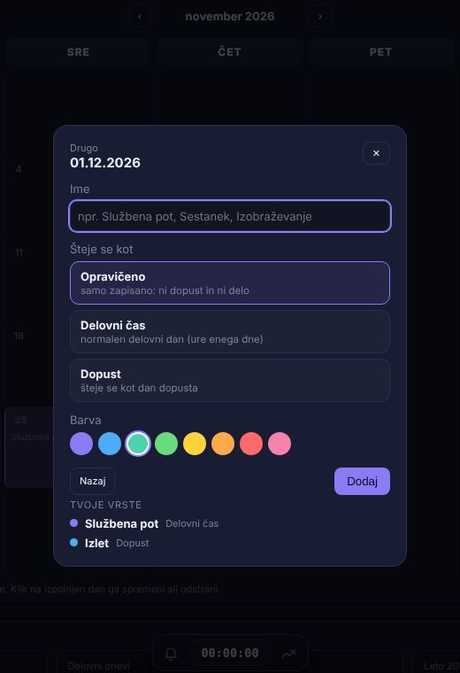

### Obračun

Prihodki in stroški po mesecih: plačilo iz ur v Evidenčnem listu, drugi prihodki, stroški, mesečni stroški (najemnina, telefon …) in varčevanje. Na koncu vidiš, koliko je ostalo na kartici.

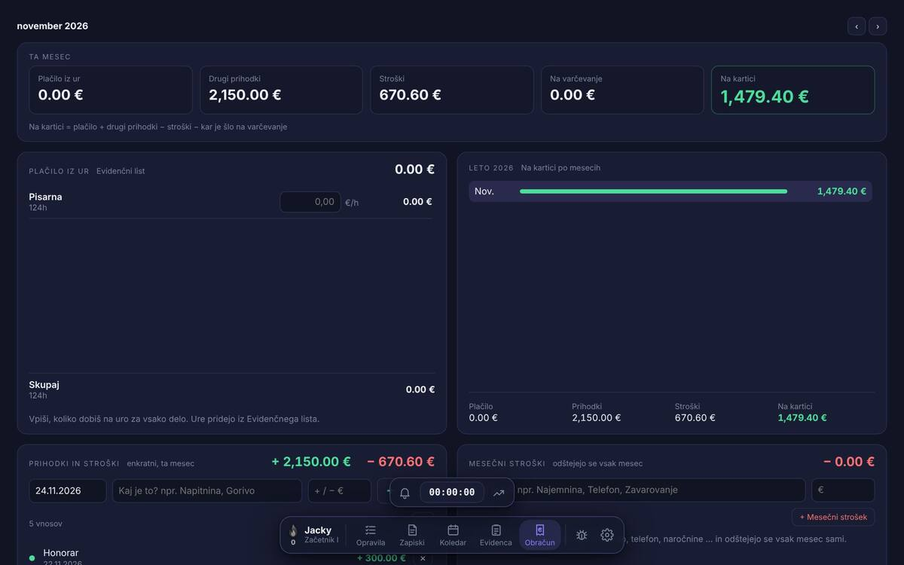

### Pošta `NOVO`

Samo maili iz Gmaila, ki so ti pomembni: tisti z oznako, ki jo izbereš (npr. »Fokus«). Ostali nabiralnik te ne moti.

- **Povezava** – z geslom za aplikacije iz Google računa. Geslo ostane samo na tvoji napravi.
- **Iz maila v koledar** – pod odprtim mailom dodaš dogodek v Koledar ali vnos v Evidenčni list. Priponke (PDF …) shraniš z enim klikom.

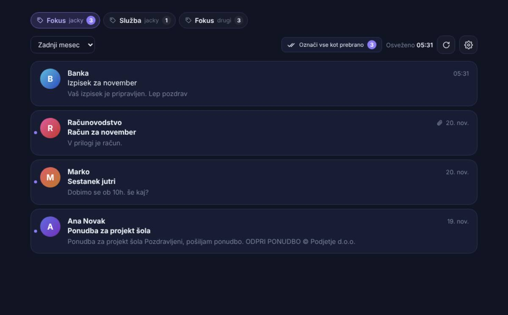
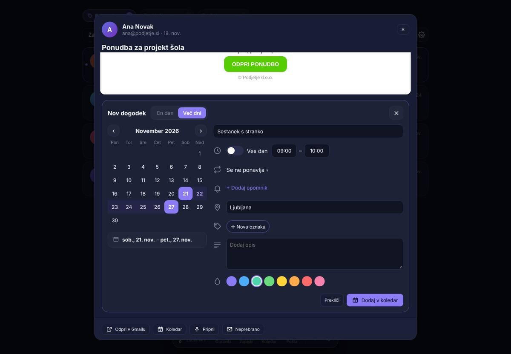

### Local Sync

Sinhronizacija med telefonom in računalnikom v istem omrežju, brez oblaka. Pri prvi povezavi izbereš, kako se podatki združijo: **Sinhroniziraj skupaj** (kasnejša sprememba obvelja), s te naprave ali z druge.

Pred prvo povezavo te aplikacija spomni, da za vsak primer narediš varnostno kopijo.

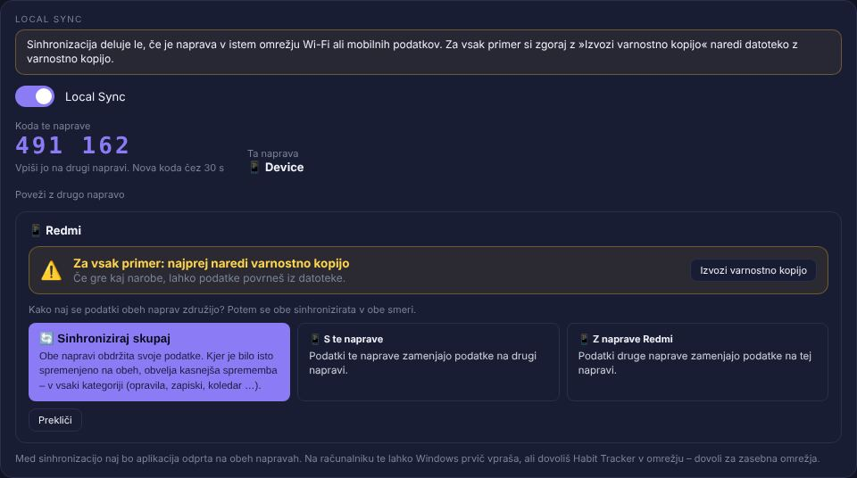

### Alarm `NOVO`

Budilka, ki utihne šele, ko si res buden. Ko zazvoni, izbereš 3 naloge v vrstnem redu, v katerem jih boš opravil.

- **Naloge** – Računi, Spomin (zaporedje kvadratov), Stavek, Barve (tapni barvo, s katero je beseda napisana), Po vrsti (številke 1–12), Koda (prepiši kodo) in Drugačen (poišči znak, ki je drugačen).
- **Samo na telefonu** – tresenje telefona ter naloge s kamero: sklece, počepi in trebušnjaki (kamera šteje ponovitve). Pri vajah najprej izbereš, koliko ponovitev boš naredil.
- **Stresi, da utihne** – na telefonu tri močna stresanja utišajo zvok in telefon začne vibrirati, vedno močneje. Po 5 minutah se zvok vrne, po 10 minutah se budilka sama ustavi (to jutro ni zmage).
- **Zvok** – sirena ali melodija budilke, ki jo imaš nastavljeno na telefonu.

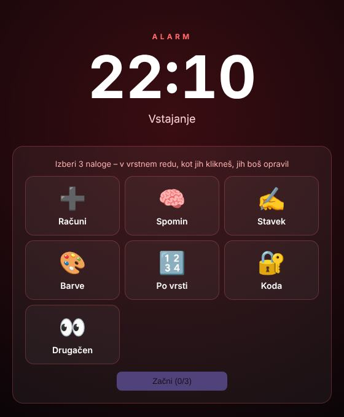

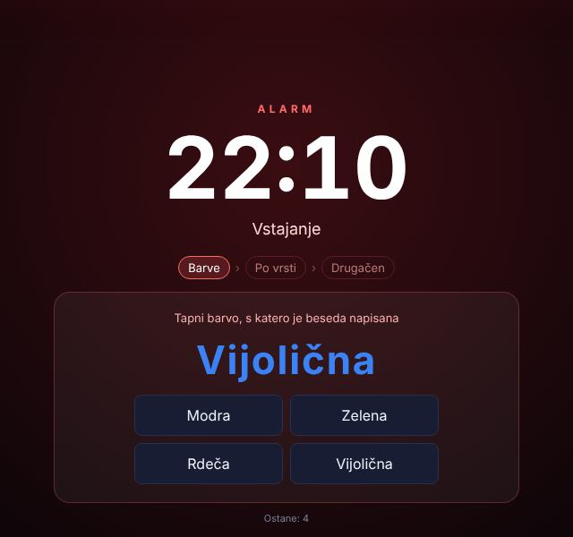

### Nastavitve in videz

Teme in ozadja, barvne ali neonske ikone, obvestila, niz in rang. Tu vklopiš ali izklopiš posamezne dele aplikacije, nastaviš Alarm in narediš varnostno kopijo.

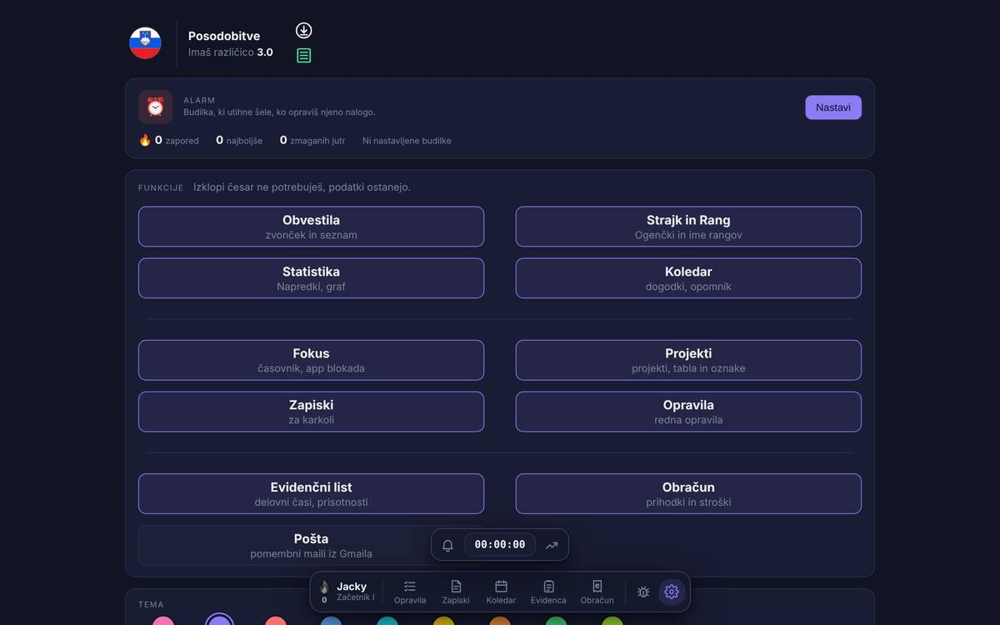

---

Habit Tracker · podatki ostanejo pri tebi
